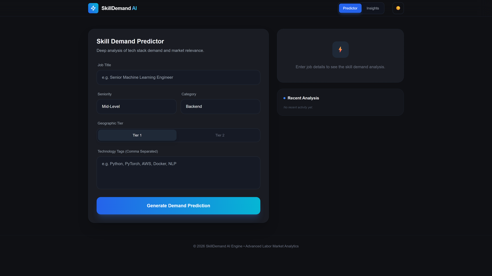
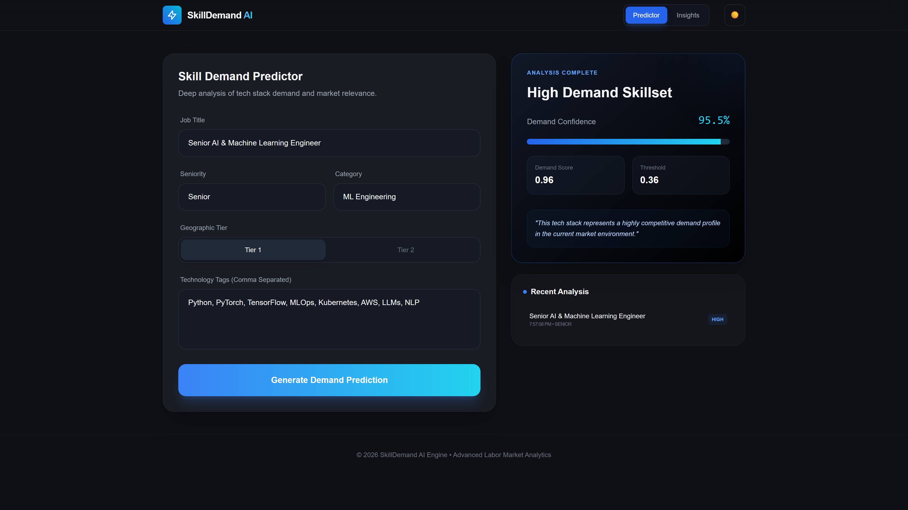
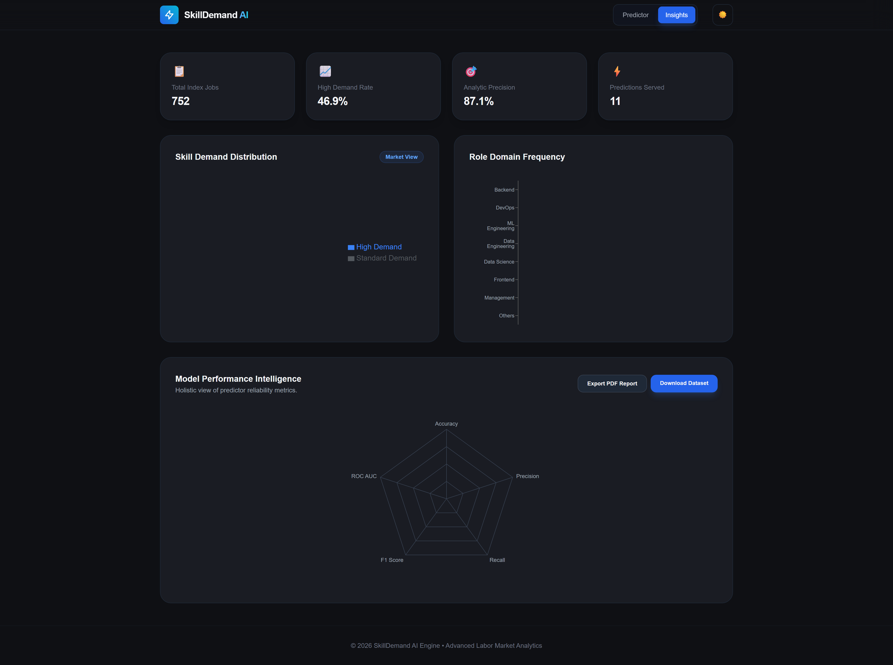
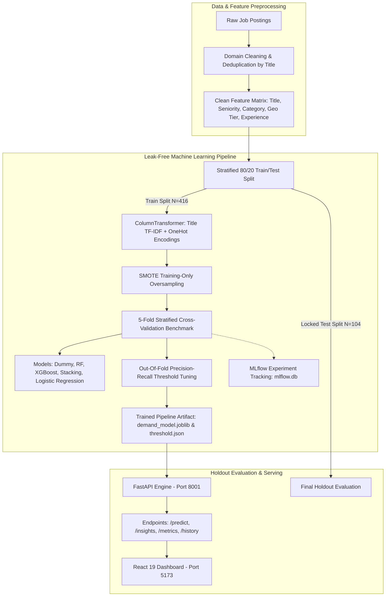

# SkillDemand AI 🚀

[](https://fastapi.tiangolo.com/)
[](https://react.dev/)
[](https://tailwindcss.com/)
[](https://mlflow.org/)
[](https://scikit-learn.org/)
[](https://xgboost.readthedocs.io/)
[](https://www.python.org/)

**SkillDemand AI** is an end-to-end labor market intelligence and predictive analytics platform. It predicts whether a technology job posting represents a **HIGH-DEMAND** skillset in today's evolving market. By combining Natural Language Processing (TF-IDF title encoding), automated feature engineering, and a SMOTE-balanced Stacking Classifier ensemble, the system delivers real-time demand scoring through a secure FastAPI backend and a dark-mode glassmorphic React dashboard.

---

## 📸 Application Showcase

### 1. Skill Demand Predictor (Form Interface)
The core predictive interface allows recruiters and engineers to input job specifications, title details, seniority, geographic tier, and technology tags.


### 2. Real-Time Demand Intelligence (Prediction Result)
Instant analysis with calibrated confidence scores, dynamic threshold assessment, and chronological prediction tracking.


### 3. Market Insights & Model Evaluation Dashboard
Holistic analytics dashboard featuring market skill demand distributions (Donut Chart), domain frequencies (Bar Chart), and model reliability metrics (Radar Chart).


---

## ✨ Key Highlights

- **🎯 Fair Multi-Model Benchmark**: Evaluates **Dummy Baselines**, **Random Forest**, **XGBoost**, **Stacking Ensemble**, and **Regularized Logistic Regression** under identical stratified 5-fold CV and locked holdout splits.
- **🏆 Empirically Selected Architecture**: Regularized **Logistic Regression** ($C=2.0$) selected over complex ensembles due to superior generalization on sparse 200-dimensional TF-IDF text features (**0.9373 ROC-AUC** vs 0.8865 for Stacking).
- **⚡ Leak-Free Threshold Tuning**: Decision boundary ($Threshold = 0.5181$) optimized strictly via out-of-fold training cross-validation (zero test-set snooping).
- **🛡️ Secure High-Throughput API**: Built with FastAPI, Pydantic data validation, and `X-API-Key` header authentication.
- **🎨 Glassmorphic React Dashboard**: High-contrast, dark-mode user interface powered by React 19, Tailwind CSS, and interactive Recharts visualizations.
- **🔬 Full MLOps Experiment Tracking**: Experiment lineage, parameter logging, cross-validation scores, holdout metrics, and artifact persistence with **MLflow** (`sqlite:///mlflow.db`).
- **🚫 Rigorous Data Leakage Prevention**:
  - TF-IDF vectorization encapsulated inside `ColumnTransformer` (vocabulary learned solely from training data).
  - SMOTE oversampling isolated to training folds inside `imblearn.pipeline.Pipeline`.
  - Removed circular tag shortcut features (`has_cloud`, `num_skills`, etc.) that trivially reconstructed the target formula.

---

## 🏗️ System Architecture



---

## 📊 Model Evaluation & Benchmarks

All models were evaluated under identical conditions on the **untouched holdout test set** ($N = 104$: 55 High Demand, 49 Low Demand). The decision threshold was chosen strictly using 5-fold cross-validation on `X_train`:

| Model Architecture | Threshold Strategy | Threshold | Test Accuracy | Precision (High) | Recall (High) | F1-Score (High) | Macro F1 | ROC AUC | Confusion Matrix `[TN, FP, FN, TP]` |
| :--- | :--- | :---: | :---: | :---: | :---: | :---: | :---: | :---: |
| **Dummy (Most Frequent)** | Baseline | 1.0000 | 52.88% | 52.88% | 100.00% | 69.18% | 34.59% | 0.5000 | `[0, 49, 0, 55]` |
| **Dummy (Stratified)** | Baseline | Random | 52.88% | 52.88% | 100.00% | 69.18% | 34.59% | 0.4666 | `[0, 49, 0, 55]` |
| **Random Forest (Tuned + SMOTE)** | Train CV OOF | 0.4597 | 77.88% | 83.33% | 72.73% | 77.67% | 77.72% | 0.8879 | `[41, 8, 15, 40]` |
| **XGBoost (Tuned + SMOTE)** | Train CV OOF | 0.4157 | 81.73% | 80.00% | 87.27% | 83.48% | 81.60% | 0.8785 | `[37, 12, 7, 48]` |
| **Stacking (RF + XGB + SMOTE)** | Train CV OOF | 0.4696 | 79.81% | 82.69% | 78.18% | 80.37% | 79.76% | 0.8865 | `[40, 9, 12, 43]` |
| **Logistic Regression (Selected Best)** | **Train CV OOF** | **0.5181** | **84.62%** | **88.24%** | **81.82%** | **84.91%** | **84.61%** | **0.9373** | `[43, 6, 10, 45]` |

### Architectural Insight: Why Linear Outperforms Ensembles Here
In a sparse 200-dimensional text vector space with a moderate training set ($N = 416$), tree-based models and stacking struggle with variance and axis-aligned splits over high-dimensional bag-of-words indicators. L2-regularized Logistic Regression ($C=2.0$) provides the optimal inductive bias, achieving **0.9373 ROC-AUC** with superior precision (**88.24%**) and robust calibration.

---

## 🔌 API Reference

The FastAPI service runs on `http://localhost:8001` and includes interactive Swagger documentation at `http://localhost:8001/docs`.

### Authentication
All prediction endpoints require the `X-API-Key` header:
```bash
X-API-Key: sg-dev-key-2026
```

### Endpoints

| Method | Endpoint | Description |
| :--- | :--- | :--- |
| `GET` | `/health` | Service health status, model readiness, and request counts |
| `GET` | `/insights` | Aggregated market statistics, category counts, and demand rates |
| `GET` | `/metrics` | Offline validation metrics and optimal threshold |
| `GET` | `/history` | Chronological log of recent prediction requests |
| `POST` | `/predict` | Single job demand inference |
| `POST` | `/predict/batch` | Batch demand inference for multiple postings |

#### Example Prediction Request

```bash
curl -X POST "http://localhost:8001/predict" \
  -H "Content-Type: application/json" \
  -H "X-API-Key: sg-dev-key-2026" \
  -d '{
    "title": "Senior AI & Machine Learning Engineer",
    "seniority": "Senior",
    "category": "ML Engineering",
    "geo_tier": "Tier 1",
    "tags": ["Python", "PyTorch", "Kubernetes", "AWS"]
  }'
```

#### Example Prediction Response

```json
{
  "prediction": 1,
  "probability": 0.7553,
  "demand_score": 0.7553,
  "threshold": 0.5181,
  "label": "High Demand Skillset",
  "experience_detected": 0
}
```

---

## 📁 Repository Structure

```text
├── .env                          # Environment configurations
├── .gitignore                    # Git ignore specifications
├── Dockerfile.backend            # Production backend container definition
├── docker-compose.yml            # Multi-container orchestration
├── pyproject.toml                # Python project configuration & dependencies
├── README.md                     # Project documentation
│
├── code/                         # Core Machine Learning & API Code
│   ├── app.py                    # FastAPI application & prediction pipeline
│   ├── modeling.py               # MLflow training, SMOTE balancing, stacking
│   ├── preprocessing.py          # Data cleaning & feature extraction
│   └── scraper/                  # Multi-source job scraper modules
│
├── data/                         # Datasets & evaluation outputs
│   ├── cleaned_jobs.csv          # Preprocessed job postings
│   ├── features_jobs.csv         # Engineered feature matrix
│   └── evaluation_metrics.json   # Model performance benchmarks
│
├── docs/                         # Project Documentation & Assets
│   └── screenshots/              # High-resolution application screenshots
│       ├── 01_skill_demand_predictor_initial.png
│       ├── 02_skill_demand_predictor_high.png
│       └── 03_market_insights_dashboard.png
│
├── frontend/                     # React 19 Frontend Application
│   ├── src/
│   │   ├── components/
│   │   │   ├── Dashboard.jsx     # Recharts analytics & metrics view
│   │   │   └── PredictionForm.jsx# Interactive demand inference form
│   │   ├── services/
│   │   │   └── api.js            # Axios client with API Key headers
│   │   ├── App.jsx               # Navigation & theme management
│   │   └── index.css             # Tailwind CSS tokens & glassmorphic styling
│   ├── package.json              # Frontend npm dependencies
│   └── vite.config.js            # Vite build configuration
│
├── models/                       # Serialized Model Artifacts
│   ├── demand_model.joblib       # Trained Stacking Classifier
│   ├── threshold.json            # Calibrated decision threshold
│   └── title_tfidf.joblib        # TF-IDF title vectorizer
│
└── tests/                        # Automated Test Suite
    └── test_api.py               # Pytest API contract and endpoint tests
```

---

## 🚀 Getting Started

### Prerequisites
- **Python**: 3.12+
- **Node.js**: 18+ & **npm**
- **uv** (recommended for rapid Python package management) or standard `pip`

### 1. Environment Configuration
Verify or adjust your root `.env` file:
```env
MODEL_PATH=models/demand_model.joblib
TFIDF_PATH=models/title_tfidf.joblib
THRESHOLD_PATH=models/threshold.json
METRICS_PATH=data/evaluation_metrics.json
PROCESSED_DATA_PATH=data/features_jobs.csv

API_HOST=0.0.0.0
API_PORT=8001
API_KEY=sg-dev-key-2026
VITE_API_URL=http://localhost:8001
```

### 2. Backend Installation & Startup
```bash
# Install dependencies with uv (or pip install -e .)
uv sync

# (Optional) Preprocess data and retrain model
python code/preprocessing.py
python code/modeling.py

# Start FastAPI server
uvicorn code.app:app --host 127.0.0.1 --port 8001 --reload
```
The backend will be available at `http://localhost:8001` (Health check: `http://localhost:8001/health`).

### 3. Frontend Installation & Startup
```bash
cd frontend
npm install
npm run dev
```
The React interface will be running at `http://localhost:5173`.

### 4. MLflow Dashboard (Optional)
To inspect experiment runs, metrics, and models in MLflow:
```bash
mlflow ui --backend-store-uri sqlite:///mlflow.db
```
Open `http://localhost:5000` to review training runs.

### 5. Running Automated Tests
```bash
pytest tests/test_api.py -v
```

---

## 🐳 Docker Deployment

To launch the full stack using Docker Compose:

```bash
docker compose up --build
```

- **Frontend**: `http://localhost:3000`
- **Backend API**: `http://localhost:8000`
- **Interactive Docs**: `http://localhost:8000/docs`

---

## 📜 License & Credits

Developed for the **Job Market Skill Demand Predictor Project**.  
Built with FastAPI, React, Scikit-Learn, and MLflow.
